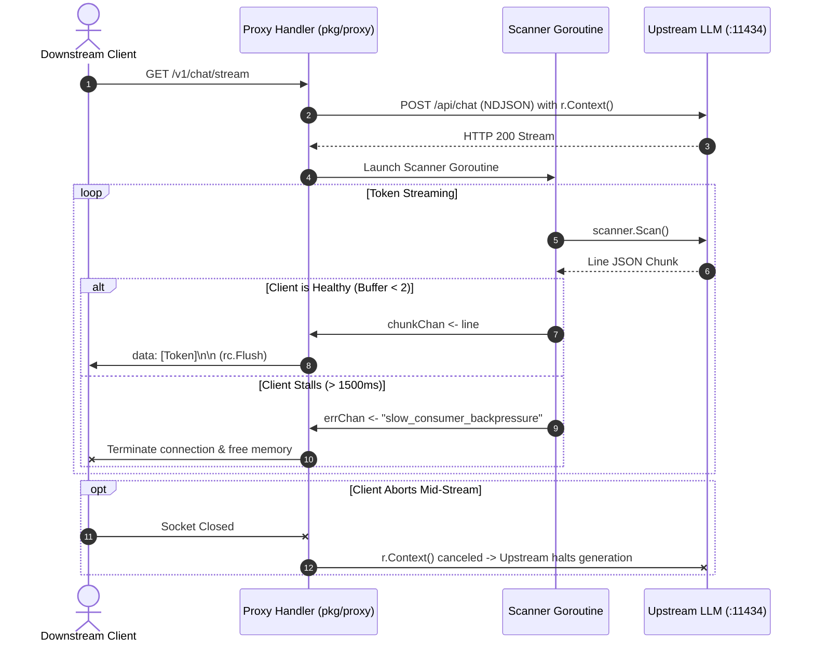
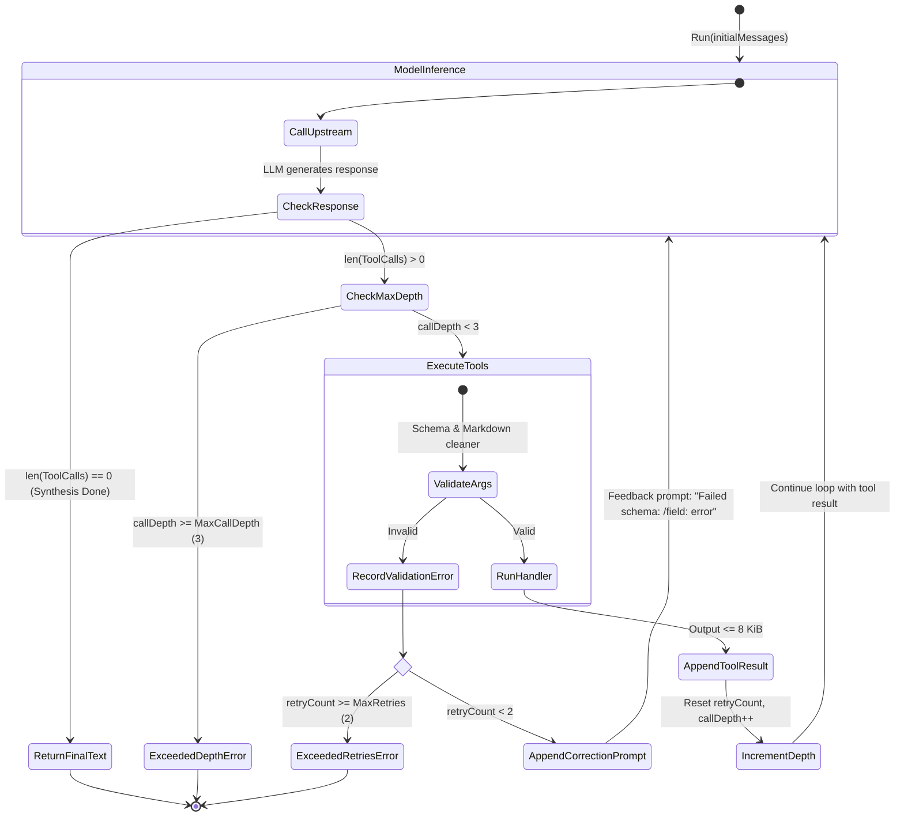

# Aegis: Streaming Reverse Proxy & Agentic Runtime

[](https://github.com/paranik-jpg/streaming_reverse_proxy/actions)
[](https://goreportcard.com/report/github.com/paranik-jpg/streaming_reverse_proxy)
[](https://golang.org)
[](LICENSE)

A high-performance, backpressure-aware Server-Sent Events (SSE) reverse proxy and resilient tool-execution runtime built in Go. Designed for serving and orchestrating LLM inference with strict systems-level guardrails.

---

## Architecture Overview

```
                      ┌────────────────────────────────────────────────────────┐
                      │              Pillar 1: Streaming Proxy                 │
[Downstream Client] ◄─┼─ SSE (/v1/chat/stream) ── [pkg/proxy] ◄── NDJSON ──── [Upstream LLM :11434]
                      │     • Bounded Channel Buffer (cap: 2)                  │
                      │     • Slow-Consumer Ejection (1.5s threshold)          │
                      │     • Upstream Compute Reclamation via context.Context │
                      └────────────────────────────────────────────────────────┘

                      ┌────────────────────────────────────────────────────────┐
                      │              Pillar 2: Agentic Tool Runtime            │
                      │                                                        │
                      │   [pkg/engine] ── Multi-Turn Self-Correction Loop      │
                      │        │                                               │
                      │        ├── [pkg/tools/registry]   (Thread-Safe RWMutex)│
                      │        ├── [pkg/tools/schema]     (Markdown/JSONSchema)│
                      │        └── [pkg/tools/dispatcher] (8 KiB Budget/Timeout│
                      └────────────────────────────────────────────────────────┘
```

---

## Key Engineering Highlights

### 1. Backpressure-Managed SSE Reverse Proxy (`pkg/proxy`)
- **Zero Buffer-Bloat Streaming**: Bridges upstream chunked NDJSON (`/api/chat`) to downstream clients using standard Server-Sent Events (`text/event-stream`).
- **Low-Latency Flushes & Deadlines**: Leverages Go 1.20+ `http.NewResponseController` to issue immediate socket flushes (`Flush()`) and enforce strict 1-second write timeouts (`SetWriteDeadline`) per token chunk.
- **Slow-Consumer Ejection**: Ingestion occurs through a tiny bounded channel (`buffer: 2`). If a slow client stalls ingestion for >1500ms, the proxy terminates the socket with `slow_consumer_backpressure` to protect host memory.
- **Cascading Compute Reclamation**: Propagates `r.Context()` directly to the upstream client. If downstream disconnects mid-stream, upstream LLM inference cancels immediately, freeing expensive GPU/CPU cycles.

### 2. Self-Healing Agentic Tool Orchestrator (`pkg/engine`)
- **Automated Parameter Correction**: Intercepts invalid tool arguments, compiles schema violation paths (e.g. `/user_id: must be >= 1`), and generates corrective system feedback prompts directly back to the model (bounded to `MaxRetries = 2`).
- **Markdown Fence Sanitization**: LLMs often wrap JSON arguments in ` ```json ... ``` ` fences. Pre-decoding sanitization strips markdown fences safely without extra allocations.
- **Precompiled JSON Schema Validation**: Uses `santhosh-tekuri/jsonschema/v5` to compile tool parameter schemas once during registration, avoiding runtime compilation overhead.

### 3. Execution Guardrails & Budgeting (`pkg/tools`)
- **Context-Bound Isolation**: Each tool execution is dispatched inside an isolated goroutine bounded by `ctx.Done()` to prevent runaway operations.
- **Output Budgeting**: Enforces a strict 8 KiB return limit (`MaxToolOutputBytes`) on serialized tool responses to defend against context-window explosion.
- **Recursion Depth Guards**: Prevents infinite tool call chains with `MaxCallDepth = 3`. Upon reaching the depth ceiling, tool declarations are stripped, forcing the LLM to synthesize a final textual answer.

---

## Streaming Lifecycle & Backpressure Flow



---

## Multi-Turn Tool Self-Correction Loop



---

## Project Structure

```
.
├── cmd/
│   ├── proxy/
│   │   └── main.go              # Streaming reverse proxy server (:8080)
│   └── mock_upstream/
│       └── main.go              # High-throughput mock inference server (:11434)
├── pkg/
│   ├── proxy/
│   │   └── proxy.go             # Reusable SSE reverse proxy handler with backpressure
│   ├── engine/
│   │   ├── engine.go            # LLM inference loop with self-healing tool calling
│   │   └── engine_test.go       # Multi-turn self-correction integration tests
│   └── tools/
│       ├── tool.go              # Tool & Handler type definitions
│       ├── registry.go          # Thread-safe (sync.RWMutex) registry
│       ├── dispatcher.go        # Isolated execution & 8 KiB output limiter
│       ├── schema.go            # JSON Schema compilation & markdown cleaner
│       ├── mock_tools.go        # Reference tools (currency conversion, user lookup)
│       └── mock_tools_test.go   # Schema validation test suite
├── Makefile                     # Build & test automation
└── .github/workflows/ci.yml     # Automated CI pipeline
```

---

## Getting Started

### Prerequisites
- Go 1.21+ (tested on Go 1.22+)

### Running the Services

1. **Start the Mock Upstream Server** (simulates Ollama/vLLM streaming):
   ```bash
   make run-upstream
   # Mock inference engine running on :11434
   ```

2. **Start the Streaming Reverse Proxy** (in a second terminal):
   ```bash
   make run-proxy
   # Aegis-AI Streaming Reverse Proxy listening on :8080
   ```

3. **Stream Tokens via `curl`**:
   ```bash
   curl -N http://localhost:8080/v1/chat/stream
   ```
   Output:
   ```text
   data: [0001-CHUNK:XXXX...]

   data: [0002-CHUNK:XXXX...]

   data: [0003-CHUNK:XXXX...]
   ```

---

## Running Tests

Run the test suite including race detection:

```bash
make test-race
```

```text
=== RUN   TestEngineSelfCorrectsInvalidToolArguments
--- PASS: TestEngineSelfCorrectsInvalidToolArguments (0.41s)
=== RUN   TestMockTools
=== RUN   TestMockTools/mock_currency_conversion
=== RUN   TestMockTools/mock_user_lookup
=== RUN   TestMockTools/invalid_currency_amount
=== RUN   TestMockTools/invalid_user_ID
=== RUN   TestMockTools/unknown_tool
--- PASS: TestMockTools (0.00s)
PASS
ok  	streaming_reverse_proxy/pkg/engine	0.555s
ok  	streaming_reverse_proxy/pkg/tools	0.265s
```

---

## License

This project is licensed under the [MIT License](LICENSE).
